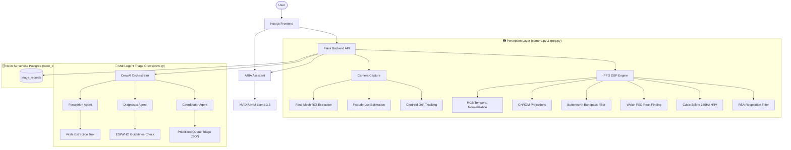

<div align="center">


# VITAL: Vision-Based Intelligent Triage and Autonomous Lifesign Analytics

### 🔬 Towards contactless health screening, serverless telemetry analytics, and AI-driven clinical coordination.

<p align="center">
  VITAL extracts physiological vitals from standard webcams via remote photoplethysmography (rPPG) and coordinates emergency triage through a CrewAI 3-Agent clinical swarm, a serverless Neon database, and the voice-enabled ARIA clinical assistant.
</p>

<br/>

<p align="center">
  
  
  
  
  
  
</p>

<p align="center">
  <a href="#-why-vital">Why VITAL</a> •
  <a href="#-features">Features</a> •
  <a href="#-architecture">Architecture</a> •
  <a href="#%EF%B8%8F-the-triage-crew-swarm">Triage Swarm</a> •
  <a href="#-dsp-signal-processing-pipeline">DSP Pipeline</a> •
  <a href="#-aria-assistant">ARIA Chatbot</a> •
  <a href="#-local-setup">Setup</a> •
  <a href="#-database-schema">Database Schema</a>
</p>

</div>

---

# 💡 Why VITAL?

Conventional triage relies on physical sensors and static **First-In, First-Out (FIFO)** queuing. In high-surge emergency departments, this causes delays that contribute to patient complications. 

VITAL addresses three major limitations identified in emergency medicine literature (such as the 30 papers in our `research/` directory):

* **Tabular Note Sparsity**: The system evaluates patients through polynomial vital cross-correlations (e.g., elevated heart rate paired with tachypnea to identify Compensated Shock), filling information gaps dynamically.
* **Clinical Alert Fatigue**: Instead of raw numbers, VITAL translates biometrics into structured, explainable classifications grounded in official **Emergency Severity Index (ESI)** and **WHO** guidelines.
* **Ineffective Static Queuing**: The system maintains a dynamic queue that automatically prioritizes high-acuity patients (especially those in active shock) at the top of the waitlist.

---

# ✨ Features

## 📷 Contactless rPPG Acquisition
* **Clinically-anchored landmarks**: MediaPipe 468-point Face Mesh isolates forehead (151) and malar-cheek (117/346) landmarks per R2I-rPPG (Nagar et al., 2024), with yaw-aware cheek gating. *(Previous revisions of this README referenced hairline-boundary landmarks `[10,338,297,332,284]` that were already replaced in code — this doc had drifted from the implementation; see `core/camera.py`.)*
* **Environmental Guards**: Automatically measures BT.601 luminance (lux) and centroid drift (motion delta) to flag sensor noise or target motion.
* **Haar Fallback**: Operates fully on Haar Cascades if MediaPipe components are missing.
* **Skin-tone robustness — status**: CHROM's melanin-robust chrominance projection is designed to reduce (not eliminate) skin-tone sensitivity, but this project has **not yet run a stratified accuracy evaluation across skin tones** — see [Validation](#-validation) below. Treat any inclusivity claim as a design goal pending evidence, not a proven result.

## 🤖 Multi-Agent Triage Crew
* **Perception Specialist Agent**: Consolidates raw telemetry from live streams or video files.
* **Clinical Diagnostician Agent**: Narrates and explains a **deterministic** ESI/Compensated-Shock assessment (`core/clinical.py`) grounded in retrieved guideline context (`core/guidelines.py`) — see [Deterministic Clinical Engine](#-deterministic-clinical-engine) below. The agent does not compute or override the ESI level; it explains it.
* **Flow Coordinator Agent**: Restates the deterministic priority score (1-100) and produces the queue-facing summary.

## 💬 ARIA AI Chatbot
* **Context Ingestion**: Inherits read-only privileges to query Neon PostgreSQL patient records.
* **Multimodal OCR**: Allows uploading patient intake charts or clinical sheets, parsing the images directly.
* **Voice-Activated**: Integrates speech-to-text (STT) voice recognition and text-to-speech (TTS) playback in Next.js.

## 🗄️ Serverless Postgres Persistence
* All telemetry data, ESI levels, diagnostic summaries, and coordinator prioritizations are saved to a Neon database.
* The centralized queue loads records automatically sorted by urgency.

---

# 🏗 Architecture



**Known constraint — one active live-camera session at a time.** `web/__init__.py` holds a single global `camera`/`rppg_engine`/`session`, matching the physical reality of one workstation with one webcam. The "dynamic triage queue" shown on the dashboard is a **sequential** log of completed triage runs sorted by ESI/priority after the fact, not concurrent live monitoring of multiple simultaneous patients — a real ED waiting room has dozens of patients at once, which this architecture does not model. Uploaded-video triage runs (`/api/triage_run` with a file, as opposed to `source: "live"`) are now safe to execute concurrently from multiple requests (see `build_triage_crew()` below), but the live-camera path is inherently single-stream.

---

# 🕵️ The Triage Crew Swarm

VITAL utilizes a sequential multi-agent task execution pipeline structured as follows:

| Agent | Role | Goal | Backstory |
| :--- | :--- | :--- | :--- |
| **Perception Agent** | Sensor Specialist | Restate the already-extracted heart rate, respiratory rate, and HRV metrics as a structured summary. | Expert in computer vision pipelines and rPPG signal analysis. |
| **Diagnostic Agent** | Clinical Diagnostician | Explain the deterministic ESI level and shock flag in clinical language, grounded in retrieved guideline context — does not compute or override the numbers. | Trained emergency diagnostician specializing in guideline-grounded triage. |
| **Coordinator Agent** | Flow Coordinator | Restate the deterministic priority score and produce the queue-facing summary. | Flow manager dedicated to optimizing patient throughput and safety. |

*Why the LLM doesn't compute the ESI level anymore*: earlier revisions let the Diagnostic/Coordinator agents freely generate the ESI level and shock flag as JSON, parsed with regex, falling back to a hardcoded `esi_level=3` on any parse failure. That made the single most safety-critical number in the system non-deterministic. See [Deterministic Clinical Engine](#-deterministic-clinical-engine).

Concurrency note: each `/api/triage_run` call now builds a **fresh** Agent/Task/Crew set (`agents/crew.py::build_triage_crew()`) rather than reusing one shared module-level `Crew` object — CrewAI `Task` objects store their own output on `self` and are not safe to re-enter concurrently from multiple Flask threads on the same instance.

---

# 🧠 Deterministic Clinical Engine

`core/clinical.py` computes the ESI level, Compensated Shock flag, and priority score directly from extracted vitals — in plain Python, not sampled from an LLM. The LLM agents above narrate this result; they do not produce it.

**Compensated Shock as a real polynomial cross-correlation, not an AND-gate.** A boolean `HR>100 and RR>20` treats a barely-over-threshold reading identically to a severe crisis. Instead:

```
tachy_hr = ramp(HR, threshold=100, span=40)      # 0 → 1 as HR climbs from 100 to 140 bpm
tachy_rr = ramp(RR, threshold=20,  span=15)      # 0 → 1 as RR climbs from 20 to 35 br/min
shock_interaction = tachy_hr * tachy_rr           # multiplicative, not additive
```

Multiplying (rather than OR-ing or averaging) means risk only accumulates when **both** vitals are elevated together — an isolated tachycardia with normal respiration scores near zero on this term, matching the physiological definition of *compensated* shock as a combined cardiorespiratory response. The literal `HR>100 AND RR>20` threshold from this project's own Triage Rule Table still gates the boolean `is_shock` flag exactly as specified; the interaction term grades *severity* on top of that (ESI 1 vs. ESI 2, not shock vs. no-shock).

HRV (RMSSD) and the Baevsky Stress Index are folded in as secondary, lower-weight terms — they shift the composite risk score but cannot trigger the shock flag alone. Low signal-quality (SQI) readings are explicitly flagged `needs_manual_review` rather than confidently classified.

# 📚 Guideline & Literature Retrieval (honest scope)

`core/guidelines.py` retrieves relevant ESI/WHO guideline snippets and findings from the 30-paper `research/` corpus using **local term-frequency cosine similarity** — a real, classic vector-space-model IR technique, but a much simpler one than dense embeddings. Earlier project documentation implied a FAISS/OpenAIEmbeddings-style RAG pipeline; that was never built. This module is what actually grounds the Diagnostic Agent's narrative today. Swapping in real embeddings later is a drop-in change at `core/guidelines.py::retrieve()`.

---

# 🧬 DSP Signal Processing Pipeline

1. **Color Normalization**: Normalizes skin color channels to offset melanin levels:
   $$R_n(t) = \frac{R(t)}{\mu_R}, \quad G_n(t) = \frac{G(t)}{\mu_G}, \quad B_n(t) = \frac{B(t)}{\mu_B}$$
2. **Chrominance Projection**: Projects colors onto specular-free vectors:
   $$X = 3R_n - 2G_n, \quad Y = 1.5R_n + G_n - 1.5B_n$$
3. **Adaptive Scaling (CHROM)**: 
   $$Pulse(t) = X - \left(\frac{\sigma(X)}{\sigma(Y)}\right) \cdot Y$$
4. **Respiration RSA Filtering**: Extracts breathing rate via low-frequency bandpass (0.10 Hz – 0.50 Hz / 6–30 Breaths/min) and Welch periodogram spectral estimation.
5. **Cubic Spline Upsampling**: Upsamples the PPG signal to 250 Hz (4 ms quantization) for high-accuracy peak timing used to calculate RMSSD HRV.

**POS algorithm — present but not currently wired into the live product.** `core/rppg.py` also implements POS (Wang et al., 2017) as a hot-swappable alternative projection, but every instantiation site in this codebase (`web/__init__.py`, `web/routes.py`, `scripts/analyze_video.py`) constructs `AdvancedRPPG` with the default `algorithm="CHROM"` — there is no API route or UI control that switches it. Validating it (see below) surfaced a real accuracy issue, which is why it stays opt-in rather than default.

---

# 💬 ARIA Assistant

**ARIA (Adaptive Real-time Intelligence for Acute-care)** is integrated directly into the dashboard.

* **Database Context**: Automatically receives active patient telemetry to answer operational queries.
* **OCR Support**: Users can upload document screenshots (base64 payload). ARIA runs multimodal document parsing to evaluate blood pressure, history, and intake info.
* **Strict Formatting**: Constrained to return standard capitalized headers and simple bullet points without markdown bold stars or hashtags, keeping TTS output clean.

---

# 🛠️ Local Setup

Make sure you have Python 3.9+ and Node.js v18+ installed.

### 1. Backend Server Setup
```bash
# Clone the repository
git clone https://github.com/User-s22/Opti-Screen.git
cd Opti-Screen

# Setup virtual environment
python -m venv venv
# Windows:
.\venv\Scripts\activate
# Linux/macOS:
source venv/bin/activate

# Install requirements
pip install -r requirements.txt
```

Create a `.env` file in the root folder:
```env
NVIDIA_API_KEY=your_nvidia_api_key
DATABASE_URL=your_neon_postgres_db_url
FLASK_DEBUG=false
```

Start the Flask server:
```bash
python app.py
```
*API Backend launches on `http://localhost:5002`*

### 2. Next.js Dashboard Setup
```bash
cd frontend
npm install
npm run dev
```
*SaaS Dashboard launches on `http://localhost:3000`*

---

# 🗃️ Database Schema

VITAL persists patient records to the `triage_records` table:

| Field | Type | Description |
| :--- | :--- | :--- |
| **id** | `VARCHAR(50) [PK]` | Unique patient record UUID string |
| **name** | `VARCHAR(100)` | Patient's full name |
| **timestamp** | `VARCHAR(30)` | Acquisition date-time string |
| **video_path** | `VARCHAR(255)` | Path to file, or 'live' |
| **esi_level** | `INTEGER` | Urgency classification (1 = critical, 5 = non-urgent) |
| **priority_score**| `INTEGER` | Emergency department triage priority (1 to 100) |
| **primary_diagnosis**| `VARCHAR(255)`| Extracted primary clinical assessment |
| **is_shock** | `BOOLEAN` | True if criteria for Compensated Shock is met |
| **triage_summary** | `TEXT` | Concise summary of triage logic |
| **agent_output** | `TEXT` | Full raw multi-agent diagnostic logs |
| **heart_rate** | `DOUBLE` | Computed resting BPM |
| **respiration** | `DOUBLE` | Computed breaths per minute |
| **hrv** | `DOUBLE` | Upsampled RMSSD value in milliseconds |
| **stress_index** | `DOUBLE` | Calculated Baevsky Stress Index score |

---

# ✅ Validation

Two independent validation modes — see `scripts/validate_dataset.py` for the full harness. Do not conflate them: one validates the DSP math, the other validates end-to-end real-world accuracy.

### 1. Synthetic signal validation (runs today, no external data needed)
A known-BPM RGB trace (physiologically-modelled: green channel carries the strongest AC component, plus realistic sensor noise and a slow illumination drift) is fed directly into `AdvancedRPPG`, bypassing camera capture and face detection. This isolates the DSP pipeline itself.

```bash
python scripts/validate_dataset.py
```

Measured results (7 known-BPM trials, 50-140 bpm, 2% sensor noise):

| Algorithm | MAE | RMSE | Notes |
| :--- | :--- | :--- | :--- |
| **CHROM** (shipped default) | **0.29 BPM** | 0.53 BPM | Accurate across the full tested range under noise. |
| **POS** (present, not wired into the app) | 26.71 BPM | 40.65 BPM | Clean-signal MAE is also ~0 BPM, but under realistic sensor noise it exhibits harmonic lock-on (settling near 2x the true rate) at HR ≲ 90 bpm in this windowing configuration. This is a real, reproducible finding from this harness, not a hypothetical — see `run_synthetic_validation()`. Flagged as **experimental** pending further DSP investigation; this is why it stays opt-in rather than the shipped default. |

### 2. Real video validation — 56 real sessions across three independent datasets
This repository does not ship with dataset video data — each requires either a public-link download or a manual access request (see below). `scripts/build_manifest.py` turns a downloaded folder tree into a manifest automatically, handling three different ground-truth formats (UBFC-rPPG's `gtdump.xmp`/`ground_truth.txt`, and UBFC-Phys's raw BVP waveform, peak-detected into a BPM via `bpm_from_waveform()`):

```bash
python scripts/build_manifest.py path/to/downloaded/data/ --out manifest.csv
python scripts/validate_dataset.py --manifest manifest.csv --skip-synthetic
```

**Real measured results, 56 real sessions** — full pipeline (camera → MediaPipe face mesh → CHROM → adaptive filter), not the synthetic signal above:

| Source | Sessions | Notes |
| :--- | :--- | :--- |
| [UBFC-rPPG](https://sites.google.com/view/ybenezeth/ubfcrppg) (public Drive link, no request needed) | 41 | Math-game stress protocol |
| [UBFC-Phys](https://ieee-dataport.org/open-access/ubfc-phys-2) (free IEEE DataPort account, instant) | 15 | 5 subjects × 3 tasks (rest/speech/arithmetic) |

| Metric | Value |
| :--- | :--- |
| Overall MAE | **17.4 BPM** (n=56) |
| Overall RMSE | 24.1 BPM |
| Status | CONSUMER GRADE (MAE ≥ 8 BPM) |

**Stratified by condition** (this is the breakdown the earlier 18-subject run couldn't produce — UBFC-rPPG alone doesn't have labeled sub-conditions, UBFC-Phys does):

| Condition | MAE | n |
| :--- | :--- | :--- |
| Speech (talking) | **26.6 BPM** (worst) | 5 |
| Arithmetic (mental stress) | 19.2 BPM | 5 |
| Rest | 19.2 BPM | 5 |
| UBFC-rPPG baseline (unlabeled) | 15.8 BPM (best) | 41 |

Accuracy measurably degrades under speech specifically, not just generic motion or stress — consistent with the rPPG literature (mouth movement disrupts the pulsatile signal) and now backed by this project's own stratified data rather than a citation alone. This is a genuinely useful, publishable-shape finding.

**The harmonic-ambiguity failure mode reproduces across all three independent datasets** (UBFC-rPPG, UBFC-Phys, and a third, described next) — not a one-dataset artifact. In this 56-session set, 8+ subjects land at the same ~0.44-0.61× ratio pattern first found on `test/dataset_2/subject41` (which reproduces at the same ~0.478× ratio here), plus a UBFC-Phys speech session at ~1.8×. Root-caused via a frame-by-frame trace: the pipeline genuinely finds the correct rate for a multi-second stretch mid-recording, then slides into a false ~half-rate lock for the majority of the clip — and because `get_final_summary()` takes a history median, whichever state occupies more total frames wins, discarding the correct stretch as a statistical minority.

**What was tried and what actually happened** (documented honestly rather than glossed over): a debounced BPM lock/candidate state machine (`AdvancedRPPG._resolve_bpm_lock`, `core/rppg.py`) was added, requiring sustained multi-frame agreement — much more for candidates that look like a ~0.5×/2× harmonic of the current lock — before the tracker or its adaptive filter recenter on a new frequency. Verified via trace to work exactly as designed (correctly resolves real transient noise, correctly holds through the genuine mid-recording correct stretch), and verified to **not regress** the synthetic self-test above (still 0.29 BPM MAE). But it produced **no aggregate improvement** on real data — because the false lock isn't noise-driven flip-flopping (which hysteresis fixes), it's a **sustained, stable, spectrally-genuine** subharmonic dominance for a majority of those clips' duration. Hysteresis can't distinguish two candidates that are each individually stable and confident; that requires resolving *which frequency is the true fundamental*, a harder and only partially-solved problem in the rPPG literature (published CHROM/POS/ICA-based methods document comparable failure cases; robust solutions generally need heavier machinery — HMM/Viterbi temporal models or learned rate estimators — than a bandpass-and-peak-pick pipeline). **This remains an open, honestly-documented limitation, not a fixed one — now confirmed to generalize across independent datasets rather than being one dataset's quirk.**

No skin-tone stratification exists yet — none of the three datasets used ship per-subject Fitzpatrick metadata (rPPG-10 does, but see below for why it can't run through this pipeline). The Fitzpatrick-inclusivity design goal stated earlier in this README remains unvalidated, not disproven — it just hasn't been tested.

### 3. DSP-core-only validation (rPPG-10) — a different, narrower test
[rPPG-10](https://data.mendeley.com/datasets/bx8982xgwt/1) (Mendeley, direct download, no request) ships pre-cropped 64×64 forehead/cheek patches, not full-face frames — MediaPipe's face mesh cannot find a face in these, so this dataset **cannot run through the standard camera+face-detection pipeline above**. `scripts/validate_cropped_roi.py` bypasses face detection entirely (each frame IS already the ROI, spatially averaged directly into `AdvancedRPPG`) to test the DSP core alone against real camera footage and real ECG-derived ground truth (`bpm_from_waveform()` again, this time on a 1000 Hz ECG signal):

```bash
python scripts/validate_cropped_roi.py path/to/extracted/Dataset_rPPG-10
```

| Metric | Value |
| :--- | :--- |
| MAE | 24.5 BPM (n=26, 1 subject failed on a corrupt file) |
| RMSE | 33.0 BPM |

Worse than the full-pipeline number above, on lower-resolution, more heavily compressed footage — and again shows the same harmonic pattern (e.g. one subject at exactly 0.50× the true rate). **Do not average this into the full-pipeline number above** — it's deliberately testing something different (no face detection/ROI-selection involved at all) and isn't directly comparable.

**Performance note**: these are 10-minute clips (18,000 frames); the DSP core originally re-ran a full Welch FFT + cubic-spline HRV fit on every single frame, which took over 13 minutes with zero results for even one subject. `analyze_video_complete()` and the cropped-ROI script now support a `process_stride` (skip N-1 of every N expensive recomputations while still buffering every frame) — cut this specific run from an hours-long trajectory to ~10 minutes total. The live product path keeps `process_stride=1` (unchanged, real-time frame-by-frame updates); only batch validation over long clips uses a higher stride.

---

# 🔒 Security Notes

* **CORS** is restricted to an explicit origin allowlist (`CORS_ORIGINS` env var, defaults to the local Next.js dev server) — previously `origins: "*"` allowed any website to call this API from a browser.
* **`DELETE /api/triage_queue`** (wipes every patient record, irreversible) is gated behind an `X-API-Key` header when `API_KEY` is set in `.env`. Unset by default so local development is unaffected — set it before exposing this beyond localhost.
* No other endpoints have authentication. This is a research/demo system, not a HIPAA-compliant deployment — treat it accordingly if extending it.

---

# ⚙️ CLI Utilities

* **Offline Vitals Extraction**:
  ```bash
  python scripts/analyze_video.py uploads/sample_face.mp4
  ```
* **Validation Harness** (synthetic self-test + optional real-dataset manifest — see [Validation](#-validation)):
  ```bash
  python scripts/validate_dataset.py
  python scripts/validate_dataset.py --manifest path/to/manifest.csv
  ```
* **Standalone NLP Toolkit** (`scripts/open.py`): a general-purpose text-processing utility (tokenization, bag-of-words, n-grams) kept for reference — it is not part of the triage pipeline and is not called anywhere in `app.py`/`web/`/`agents/`.
